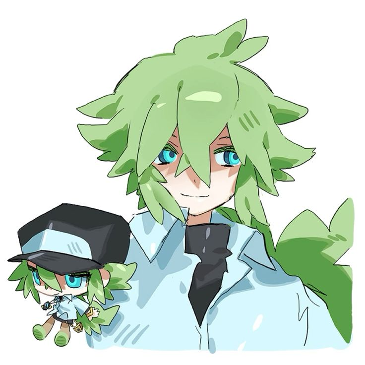
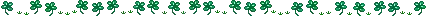

<table>
<tr>
<td width="90%" align="center" valign="top">
  

  
    

  I've never told about how much i love N, because honestly he helped me a lot even though he's just a fictional character. Don't get me started with how i resonate much with him, especially his past trauma. At first, I thought he was just a chill guy who's willing to guide you throughout your journey because of some fanart of him smiling at the viewer. but GOD, it was beyond that. I started taking interest in him that i started searching more about N. memorizing his full name, learning about his personality, how his story goes. And I've never felt more intense for a character like him, N means so much to me. I can give you so many reasons why i love N.
  

  

  1. his design
  

  

  while i may be the biggest critique when it comes to observing N's whole design, i still can't find myself taking it to heart. the inconsistencies of his eye color, his pendant, his shoes. it doesn't matter, it's part of what makes me love him for who he is.
  

  

  2. his voice
  

  

  N's voice is so perfect. the anime, the dubs, pokémon masters ex, i could use it as my ringtone and just listen for who knows how long. his voice actors did a good job executing his tone, speech, and how i imagined what he sounds like.
  

  

  3. his personality
  

  

  despite everything that has happened to N, it never made him want to hurt anyone. even during B1W1 era, whereas his view of the Trainers and Pokémon are black-and-white. the way he refuses to let Pokémon suffer by the hands of humans, how unrealistic his ideals are, despite his good intentions, he was going through a bad method all because he was manipulated by his father figure that led to shaping his belief and how he saw the world.
  

  

  4. his childhood
  

  

  I get so protective whenever i see young N. he deserves the world, if only he was kept by a loving parent or a family to support him as he grows up. no kid deserves to be abandoned and groomed to be exploited, no matter how strange they are. but thanks to his foster sisters, Anthea and Concordia. they get to learn so much together, and I'm really happy by the way they treat him.
  

  

  5. his willingness to change
  

  

  it took him 2 years until he showed up to us again. and i can tell he still has a long way to go, but he's doing a great job to make up with the damage he cost to the Trainers and Pokémon involved in the Unova Region. Rood even gave us his zorua to take care of, just imagine keeping a part of N with you. i loved that more than anything, it made me indecisive to choose an option between evolving Zorua to Zoroark or keep it the way it is.
  

  

  6. his mannerism
  

  

  it's canonically confirmed that N talks fast. i just wonder what's going on inside his head to be forming a sentence that feels strange and hard to understand for some people. he also has childlike innocence, the ferris wheel still fascinates him. I can't blame him because i like the wind and the view from above when i hop aboard.
  

  

  7. his screentime
  

  

  i love seeing him in every scenes. animations, animation memes, fanarts, music videos, video games. just seeing him makes me go crazy, I can't even handle the embarrassment and the overwhelming admiration i have for N.
  

  

  8. his roles in the franchise
  

  

  N being the major antagonist because he's an important opposing rival to the protagonist. imagine this tall green-haired guy meeting up with you and challenging your belief and perspective, damn that's enough to make me go insane. he also became The King of Team Plasma, and then formerly as he left. he also became a supporting ally against Ghetsis and Team Plasma.
  

  

  9. his fanarts
  

  

  main reason why i was interested in N in the first place. the fanarts drew me in, the color palette, the lineart, the silhouette of his character, his facial expression and his stances, all captured in an art. man, it inspired me to draw him more until i get satisfied with how i draw him. the arts gave me more reason to appreciate the artistic skills and his character.
  

  

  10. his expressions
  

  

  the blank gaze, his solemn expression, the calm face, the intense stare, the confident smile. how he expresses his feelings fascinates me, i just wonder if it's easy to make him happy or how long it would take until his composure crumble if something heavily upset or overwhelmed him.
  

  

  11. his height
  

  

  i love how N didn't reach 6'0" ft, but he's averagely tall enough. if he were real, I'll definitely mount on this guy and tell him to walk me home. but honestly, he's tall enough to reach up and down and i would feel safe around him as well.
  

  

  12. his bond with Pokémon
  

  

  the way he calls the Pokémon as his friends, they're definitely family because he grew up being around them. he can easily communicate with them as if it was natural, N barely lies so i believe he does understand their hearts and emotions.
  

  

  13. his motivational speech
  

  

  when i first played the game, i only came for N to see him and learn more about him. had fun playing and grind for hours to reach the end, i wasn't expecting him to give me a motivational speech after i defeated both him and Ghetsis. it made me speechless and happy, i couldn't focus entirely.
    

  14. his appearance 2 years later
  

  

  he may have appeared 2 years later on B2W2, but it was worth the shot. his entrance was epic, saving the new protagonist from Kyurem's attack. i prefer his interaction with Nate because they're both my favorite characters in the game.
  

  

  15. his Pokémon Masters EX outfits
  

  

  i find N hot in every version. his anniversary outfit is gorgeous and magnificent, his sygna suit outfit brings out another style that suits him, his summer outfit is simple but adorable, his arc suit outfit looks like an alternative style for him. i hope he gets another stylish outfits, even as someone who hasn't played the game yet but i can still admire him.
  

  

  

  N isn't only my favorite character, he's my comfort, my fiction kin, and my fictional other, i see myself in him, but i also see him as my other half. it really soothes me when someone makes an effort to talk about N to me, sometimes even joking about him, or associating me with him makes me appreciate it so much. i get so happy when people starts calling me N or becoming the first thought when he appears. when i detach or isolate, all i think about first is N and it regulates my emotions. whenever i feel alienated from social interaction, i think about his experiences as someone who was also sheltered for years and it reminds me that somewhere out there, I'm not alone. don't get me started on academics, the letter N and the word Natural is so common especially in mathematics and science, along with philosophy and arts. i cannot have one day without my mind thinking about him whenever i encounter anything remotely close to N. when i tell you, i knew him years ago but only from the name but his appearance was a bit blurry for me to remember that i didn't recognize it was the same character that I will admire several years later. a part of me is grieving the loss that i didn't start loving him sooner. another part of me is also glad i get to love him later to avoid any unbearably cringe moments from childhood, and it means if i started loving him earlier might lead to moving on from N as i grow older.
  

  

  <a href="https://github.com/casinotown">casinotown</a>
  <a href="https://github.com/daggerstruckmage">daggerstruck</a>
  <a href="https://github.com/kaotown">kaotown</a>
  <a href="https://github.com/Knox-Event">knox event</a>
  <a href="https://github.com/music-town">music town</a>
  <a href="https://github.com/piddlesjet">piddles jet</a>
  <a href="https://github.com/Ponyhonors">pony honors</a>
  <a href="https://github.com/pony-town-nominations">pony town nominations</a>
  <a href="https://github.com/Ponytowns-rewards">pt awards</a>
  <a href="https://github.com/pt-everypony">pt everypony</a>
  <a href="https://github.com/pt-fashion">pt fashion</a>
  <a href="https://github.com/pt-heavyfictkin">pt heavy fictkin</a>
  <a href="https://github.com/pt-icon">pt icon</a>
  <a href="https://github.com/pts-r0ttingeyes">pt rotting eyes</a>
  <a href="https://github.com/pt-ship-nominations">pt ship nominations</a>
  <a href="https://github.com/THE-TEMPIST">the temptist</a>
    </td>
